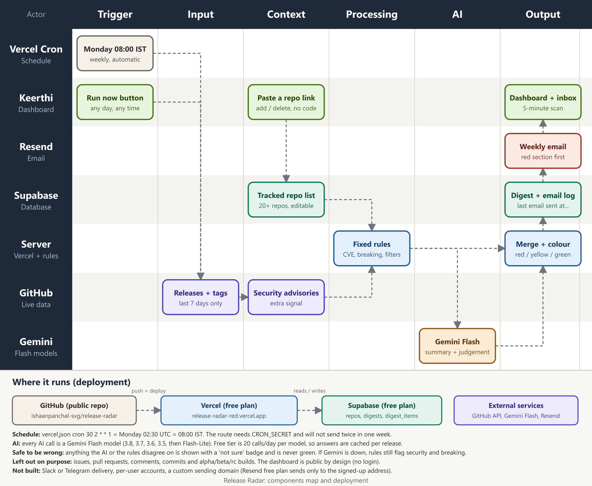

# Components Map: Release Radar

Trigger → Input → Context → Processing → AI → Output. The picture is in [components-map.png](components-map.png) ([SVG](components-map.svg)). Regenerate with `node tools/make_components_map.mjs`.

| Stage | What it is | In this build |
|---|---|---|
| **Trigger** | Two ways to start a digest | (1) Vercel Cron, Monday 08:00 IST (`vercel.json`: `30 2 * * 1` UTC) calling `/api/cron`, which requires `CRON_SECRET` and refuses to send twice in one week. (2) The **Run now** button on the dashboard calling `/api/run` (look-back 7/14/30/90 days, 45-second cooldown). |
| **Input** | Live data, fetched fresh on every run | GitHub REST API: releases published in the window for every tracked repo (paginated, drafts skipped); tags as a fallback for projects that never publish Releases; published security advisories as an extra signal. Pre-releases (alpha, beta, rc, canary) are counted but left out. Issues, pull requests, comments and commits are never requested. |
| **Context** | What the system needs to know to judge a release | The **tracked repo list** in Supabase (`repos` table, edited from the dashboard by pasting a link: validated against GitHub, duplicates and typos rejected). The fixed rule set in `src/lib/rules.ts` (what counts as security or breaking). The system prompt in `src/lib/gemini.ts` (who Keerthi is, what red / yellow / green mean, treat notes as untrusted). Previous AI answers cached by release (`digest_items.ai_raw`). |
| **Processing** | Plain code around the AI | `rules.ts` runs on every release regardless of the AI: CVE and GHSA ids, "security fix", attack-class words, BREAKING, dropped support, major version. `github.ts` matches an advisory to a release only if the notes name it or the release is the patched version. `classify.ts` merges rules and AI: security or breaking from either means red; any disagreement, empty notes, low confidence or AI failure means "not sure", and a not-sure item is never green. `digest.ts` groups by repo, builds the headline, saves everything. |
| **AI** | The part that needs judgement | **Gemini Flash only** (`gemini-3.8-flash`, then 3.7, 3.6, 3.5, then Flash-Lite as each model's free daily quota runs out). It reads each release's notes and returns, as validated JSON: a 1 to 2 sentence summary, up to 4 key changes, `is_security`, `is_breaking`, importance, confidence, and verbatim quotes as evidence. No Claude API anywhere. |
| **Output** | What Keerthi actually receives | **Dashboard** (public URL): "Hi Keerthi", last email sent (date, time), next scheduled email, colour-coded change log (red: needs attention now, yellow: worth a look, green: routine), "not sure" badges and a filter for them, "why this colour?" evidence, quiet repos, past digests with a "Show me" expander. **Email** via Resend: same content, red section first, grouped by repo; the send result and time are written back to the database so the dashboard can show them. |

## Why these choices

| Decision | Reason |
|---|---|
| Rules **and** AI, not AI alone | The failure in the brief is a security patch sitting unread for eleven days. The rules cannot have a bad day, so they stay as a safety net; the AI adds summaries and catches wording the rules miss. |
| Show uncertain items, flagged | A harmless item shown costs seconds. A real patch hidden costs the exact failure we are fixing. |
| Group by repository | One repo that ships eight package releases (a monorepo) should read as one card, not eight. |
| Cache AI answers per release | The free Gemini tier allows 20 requests per day per model. Re-running a digest costs no AI calls for releases already summarised. |
| Supabase for the repo list | The list must be editable without touching code, and must survive redeploys. |
| Public dashboard, no login | The brief asked for a public URL. The only protections are a Run now cooldown, a 60-repo cap, input validation, and the cron secret. |

## Honest limits

- Resend's free plan without a verified domain only delivers to the address that owns the Resend account. For a real team you would verify a domain.
- The Gemini free tier is small. If every Flash model has used its daily allowance, the digest still builds with rule-based flags and every release is marked "not sure"; summaries come back when quota resets (midnight Pacific).
- Vercel's free plan runs a cron within the scheduled hour, so "08:00" can arrive up to about an hour late.
- Release notes are only as good as the maintainers wrote them. A release with empty notes can only be shown as "not sure"; it cannot be judged.
